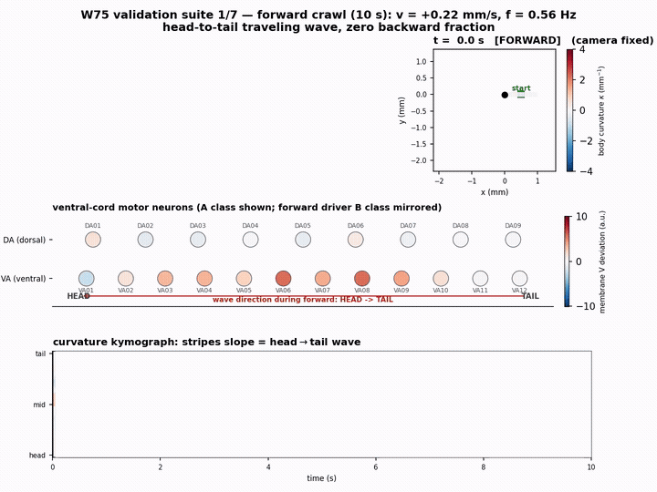
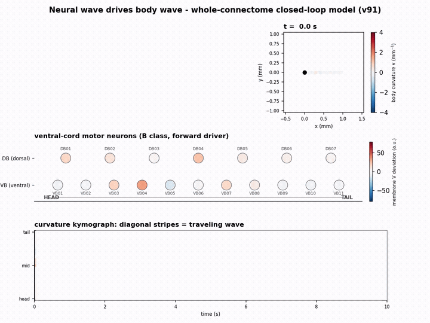

# Whole-worm platform — model release v3

Self-contained release accompanying the preprint

> *"A physiology-anchored, full-channel whole-worm platform: building
> Caenorhabditis elegans in silico, block by block, from measured constants"*
> (October 2026).

Every numerical constant in the running configuration is either a direct
literature measurement or a bounded estimate declared as such in the
manuscript (Tables 4–6). No parameter is trained.



*A 10 s forward crawl, simulated by the closed loop below. Top right: the body
coloured by curvature; middle: ventral-cord motor-neuron activity propagating
head → tail; bottom: curvature kymograph — the diagonal stripes **are** the
travelling wave, emerging from the loop rather than being injected. Reproduce
with assay 1 below and `figures/make_suite_movies_v3.py`.*

## What this is

A closed-loop whole-animal simulation of *C. elegans*:

- **Nervous system** — 323 cells, conductance-based (29 ODEs per cell,
  17 currents), wired by the frozen connectome (4,450 chemical + 1,219
  gap-junction edges; weights = EM contact counts from Cook et al. 2019 /
  Witvliet et al. 2021).
- **Muscle layer** — 96 body-wall muscle cells (24 rows × 4 quadrants),
  each a first-order integrator driven through the anatomical
  motor-neuron→muscle innervation table, with measured NMJ constants.
- **Body** — original 24-segment viscoelastic rod (`engine/rod2d_own.py`)
  in preferred-curvature form.
- **Closed loop** — proprioceptive feedback from body curvature re-enters
  the motor neurons; the undulatory wave is an emergent property of the
  loop, not an injected rhythm.

The champion stack is entirely original code (`rod2d_own.py`,
`muscle96.py`); no third-party body layer is required for any result
reported in the manuscript.

## Architecture at a glance

```
        sensory neurons                command interneurons
   ASH  ASE  ALM/PLM  AFD  PVD      AVA (backward)   AVB (forward)
        │  chemical + gap-junction edges, EM-count weights  │
        ▼                                                   ▼
   ─────────────────────────────────────────────────────────────
              motor neurons: A / B / D classes + SMD
   ─────────────────────────────────────────────────────────────
                           │  anatomical innervation table
                           ▼
              96 body-wall muscles (muscle96.py)
                           │  graded contraction
                           ▼
        24-segment viscoelastic body (rod2d_own.py)
                           │
                           └──── proprioceptive feedback ────┐
                 body curvature re-enters the motor neurons  │
                 (Wen et al. 2012) ──────────────────────────┘

        peptidergic / state layer (NLP-12→CKR-2, NLP-18→CKR-1,
        dopamine → gap-junction modulation) rides on top and
        re-tunes gains with behavioural state.
```

The wave, viewed from the neuron side — the same loop, same run:



## Layout

```
engine/
  v62_closed_loop.py       entry point (closed loop: network <-> muscle <-> body)
  anchored_engine_v5x.py   conductance-based neuron layer (v55->v56->v57->v58 chain)
  jax_circuit*.py, v62_*_circuit.py   network integration backends
  muscle96.py, muscle_maps.py         96-cell muscle layer (24 rows x 4 quadrants)
  rod2d_own.py             24-segment viscoelastic body (preferred-curvature form)
data/
  net_pure323_M6_rimlgc55.npz          frozen connectome (323 cells; weights = EM contacts)
  vrel_in_situ_v7h2_2026-10-21.npy     in-situ graded-release thresholds
  muscle96_constants.csv               muscle-layer constants, per-row provenance
  neuron_muscle.csv                    anatomical MN -> muscle innervation table
  *_manifest.json                      build manifests for the frozen tables
protocols/
  champion_base.txt        frozen base configuration (verbatim CLI arguments)
  chemotaxis_block.txt     chemotaxis assay overlay (verbatim CLI arguments)
figures/                   figure and movie factories (read trajectories from runs/)
assets/                    the demo GIFs shown above
runs/                      trajectories land here when you run the assays
```

## Requirements

Python 3.10+ with `numpy`, `scipy`, `jax` (CPU build sufficient), `numba`;
`matplotlib` + `imageio-ffmpeg` for figures/movies:

```
pip install -r requirements.txt
```

A 20 s trial simulates in a few minutes on one CPU core.

## Quick start (3 s smoke run)

Run from this directory:

```
python engine/v62_closed_loop.py $(cat protocols/champion_base.txt) --smoke --out runs/_smoke
```

(Windows CMD: paste the contents of `protocols/champion_base.txt` inline in
place of `$(cat ...)`.)

Expected tail of the log: a saved `runs/_smoke/v62cl_smoke.npz` and a
metrics line with `v_forward ≈ +0.2 mm/s`, `freq ≈ 0.5 Hz`, no NaN.

## Reproducing the seven assays

The base arguments are those of `protocols/champion_base.txt` (`$BASE`);
per-assay overlays:

| # | Assay | Command overlay | Duration |
|---|-------|-----------------|----------|
| 1 | Forward crawl | `$BASE --secs 10 --tag crawl_regress` | 10 s |
| 2 | Chemotaxis 90° | `$BASE $(cat protocols/chemotaxis_block.txt) --secs 18 --tag chem_d090` | 18 s |
| 3 | Chemotaxis 270° / 180° | same block with the source relocated so the initial heading error is 270° / 180°; the 180° run adds `--pirrev 120` | 18 s / 20 s |
| 4 | Gentle-touch escape | `$BASE --proto avapulse --pamp 400 --secs 18 --tag touch400` (AVA pulse 6–8 s) | 18 s |
| 5 | ASH chemical escape | `$BASE --proto ashchem --ashchem 400 --secs 20 --tag ash400` (two-pulse window; the modulation layer of Fig. 8d is off) | 20 s |
| 6 | AVA photo-switch F→B→F | `$BASE --proto switch --pamp 400 --secs 15 --tag switch1` (AVB 0–10 s, AVA 10–22 s, AVB after) | 15 s |
| 7 | RIS arrest | `$BASE --proto ris --secs 20 --tag ris` (RIS excited 12–18 s) | 20 s |

All commands write trajectories to `runs/v62_closed_loop/` (add
`--out runs/v62_closed_loop`).

Example, assay 1 in full:

```
python engine/v62_closed_loop.py \
  --net data/net_pure323_M6_rimlgc55.npz \
  --vrel data/vrel_in_situ_v7h2_2026-10-21.npy \
  --gate relg --turnmode event --kmax 16 --gsr 0.62 --span 0.20 \
  --pep 0.25 --pep2 10 --stim 0 --fc2 4 --fc2mn 6 --gsyn 0.02 \
  --mnprop2 -12 --mnoffset2 -6 --mnback 1 --avahold 0 --mnprop2tau 80 \
  --muscle96 0.10 --m96sig sp --m96tau 15.5 --m96tau2 300 --m96gate 0 \
  --m96ei 0.6 --smdprop -24 --smdpropseg 3:9 --smdpropbw 1 --ggap 1.0 \
  --gabaegl36 0.6 --avaplat2 25 --avaplat2tau2 0.5 --bwrefr 4.0 \
  --avamaster 0 --avarect 1 --sloa 1.0 --sloatau 1.0 --sloath 15 \
  --amnosc 1.0 --amnclip reflect --amndir posterior --amnprop 18 \
  --amnoffset 8 --amnhp 1.0 --bmnhp 1.0 --m96gj 1.0 --risdrive 14 \
  --ristau 1.0 --ristau2 0.3 --risbrk 2.0 --risbrkth 6.0 --riskill 1.5 \
  --ggapmod 1.0 --rod2d own --vdsp 0.3 --wrst 2.0 \
  --secs 10 --tag crawl_regress --out runs/v62_closed_loop
```

## Regenerating figures and movies

Once the trajectories above exist in `runs/v62_closed_loop/`:

```
python figures/make_figs_v3.py         # Figures 1–8 (PNG + PDF into figures/figs/)
python figures/make_suite_movies_v3.py # Supplementary Movies S1–S8 (the assay suite)
python figures/make_supp_movie_v3.py   # Supplementary Movies S9–S10 (oscilloscope views)
```

## Provenance

Connectome: Cook et al. 2019 / Witvliet et al. 2021 adjacency releases
(EM contact counts). Channel gating constants: single-neuron models of
Nicoletti et al. 2019/2024, with three currents re-derived from digitized
voltage-clamp data by the extraction pipeline described in the manuscript.
Muscle, proprioception, peptidergic and state-dependence constants: see
Tables 4–6 of the manuscript; per-row provenance ships in
`data/muscle96_constants.csv`.

The champion body layer (`engine/rod2d_own.py`, `engine/muscle96.py`) is
original code implementing published equations. A legacy mode
(`--rod2d borrowed`, muscle layer off) exists for reproducing archived
early-development runs and requires the third-party worm-whisperer package
(https://github.com/kairess/worm-whisperer), which is **not** part of this
release and is not exercised by any reported trajectory.
